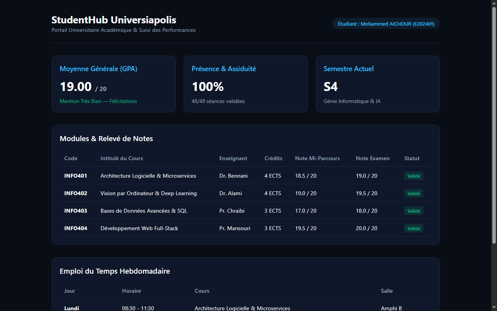
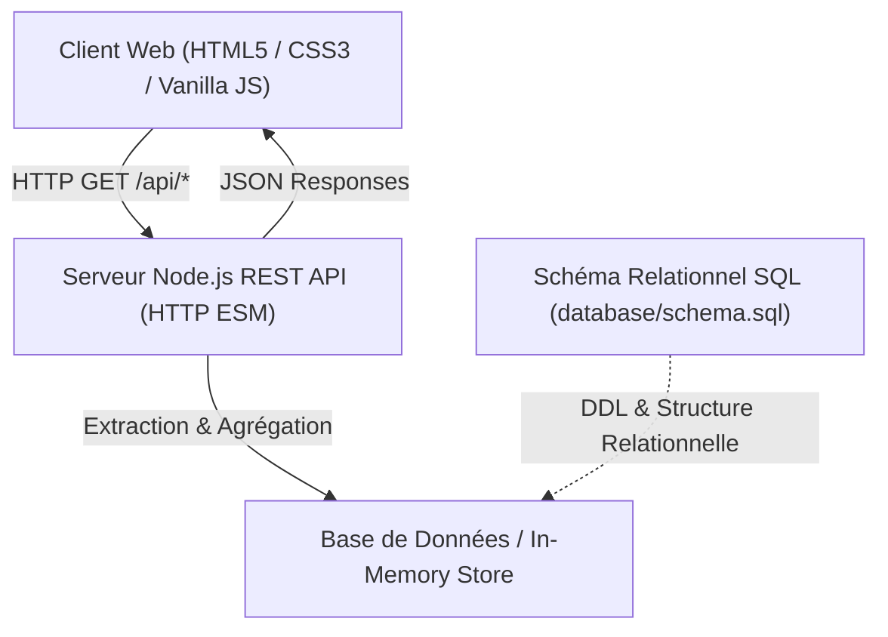
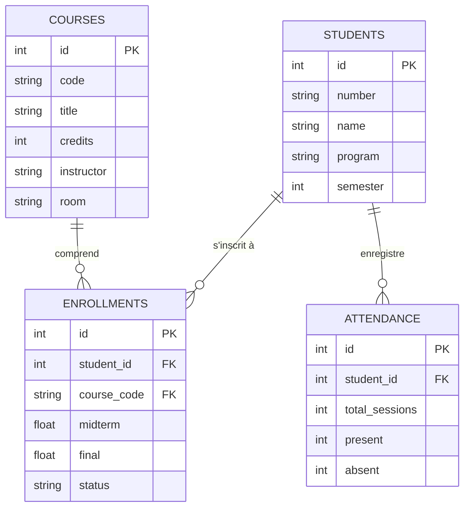

# StudentHub — Academic Management & Student Portal

> **Designed & Engineered by Mohammed AICHOUR**  
> *Full-Stack Software Engineer & Solutions Architect*

[](https://nodejs.org/)
[](https://developer.mozilla.org/)
[](https://www.mysql.com/)
[](#)

<p align="center">
  
</p>

---

## 📌 Présentation du Projet

**StudentHub** est une plateforme web universitaire centralisée permettant aux étudiants et enseignants de suivre le cursus académique, les relevés de notes, les calculs de moyennes (GPA), l'assiduité et les emplois du temps hebdomadaires en temps réel.

### Fonctionnalités Clés :
- 📊 **Relevé de Notes & GPA Automatisé** : Calcul transparent des moyennes semestrielles et annuelles.
- 📅 **Emploi du Temps Dynamique** : Visualisation claire des cours par salle, enseignant et horaire.
- 🎓 **Gestion des Inscriptions aux Modules** : Suivi des crédits ECTS par matière.
- ⏱️ **Suivi d'Assiduité** : Contrôle de présence et statistiques d'absences.
- 🔌 **API RESTful intégrée** : Service JSON prêt pour l'intégration mobile et client web.

---

## 🏗️ Structure du Projet

```text
studentHub/
│
├── database/
│   └── schema.sql              # Schéma SQL relationnel normalisé
│
├── public/
│   └── index.html              # Interface utilisateur du portail étudiant
│
├── server/
│   └── index.js                # Serveur HTTP & API RESTful (ES Modules)
│
├── tests/
│   └── test_studenthub.js      # Suite de tests d'intégrité automatisés
│
├── package.json
└── README.md
```

---

## 📡 Documentation de l'API RESTful

| Méthode | Point d'Accès | Description | Format de Réponse |
|---|---|---|---|
| `GET` | `/api/student` | Informations de profil de l'étudiant | JSON `{ success, student }` |
| `GET` | `/api/courses` | Liste des modules de formation et enseignants | JSON `{ success, courses }` |
| `GET` | `/api/grades` | Notes de contrôles, examens et calcul du GPA | JSON `{ success, grades, gpaOutOf20 }` |
| `GET` | `/api/schedule` | Emploi du temps hebdomadaire détaillé | JSON `{ success, schedule }` |
| `GET` | `/api/attendance` | Statistiques de présence et taux d'assiduité | JSON `{ success, attendance }` |

---

## 🏛️ Architecture & Modèle Relationnel

### Architecture du Système



### Schéma Entité-Association (ERD)



---

## 🚀 Démarrage Rapide

### 1. Démarrer le serveur
```bash
npm start
```
Accédez ensuite au portail via : `http://localhost:3005`

### 2. Lancer les tests automatisés
```bash
npm test
```
La suite de tests vérifie l'intégrité des modèles de données, le calcul précis des moyennes (GPA), la conformité syntaxique du schéma DDL SQL et les 5 points d'accès HTTP REST.

---

## 👨‍💻 Concepteur & Développeur

**Mohammed AICHOUR**  
- GitHub : [@Mohammed-aichour](https://github.com/Mohammed-aichour)  
- Profil & Portfolio : Intégré au portfolio professionnel officiel.
